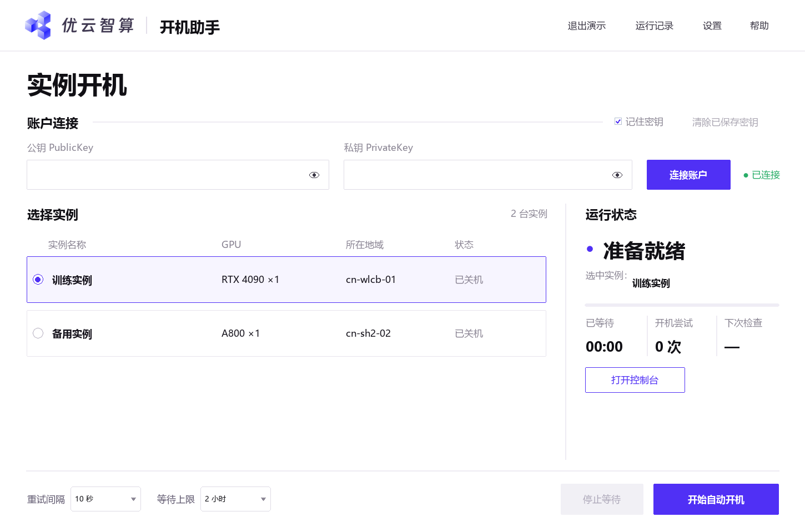

# CompShare 开机助手

**[下载 Windows 免安装版 v0.4.6](https://github.com/shenyangw591-prog/compshare-start-assistant/releases/download/v0.4.6/CompShareStart-v0.4.6-windows-x64.zip)** · [查看所有版本](https://github.com/shenyangw591-prog/compshare-start-assistant/releases)

下载 ZIP 后右键「全部解压」，打开文件夹，双击 `CompShareStart.exe`。

**优云智算已有 GPU 实例自动重试开机，给不想一直守着控制台点开机的人。**

中文图形界面 · 无需填写实例 ID · 缺卡自动等待 · 成功弹窗与提示音 · 可加密记住密钥

这是社区开源工具，非优云智算官方产品。仅使用平台公开 API；无法保证资源不足时一定抢到。



## 新手三步上手

1. **连接账户**：打开 [账户中心 → API 密钥](https://console.compshare.cn/uaccount/api_manage)，复制 `PublicKey` 和 `PrivateKey`，粘贴到助手中，点击「连接账户」。默认勾选「记住密钥」，连接成功后加密保存，下次打开自动填入。
2. **选择实例**：在列表里点一下你已经创建的 GPU 实例。不用自己找地域、可用区或实例 ID。
3. **开始自动开机**：点击「开始自动开机」。默认约 10 秒检查一轮，最多等 2 小时；确认平台状态为运行中后停止并响铃，弹出置顶的「开机成功」提示。可直接点击「打开控制台」，或点击「知道了」关闭提示。

不确定怎么操作？打开「帮助」→「体验离线演示」，不需要密钥，也不会连接云平台。

## 下载与启动

### 普通用户：Windows 免安装版

从本仓库的 **[Releases](https://github.com/shenyangw591-prog/compshare-start-assistant/releases)** 获取 `CompShareStart-v0.4.6-windows-x64.zip`，解压后双击 `CompShareStart.exe`。 **不需要安装 Python，不需要管理员权限。** 支持 Windows 10 / 11 x64。

更新时先关闭旧版，将新包解压到一个新文件夹，再运行其中的 EXE。窗口标题应显示 **v0.4.6**，运行记录也会显示版本号。保存的密钥位于用户目录，更新程序后仍可自动填入。

也可双击包内的 `体验演示模式.cmd`，先使用模拟数据体验完整流程。

当前本地构建的 EXE 未做代码签名。你可以核对发布包附带的 SHA256，或直接运行可审查的源码；不要关闭系统安全防护。

### 开发者：运行源码

需要 Python 3.9+，并带有 Tkinter（Windows 官方 Python 安装程序通常已包含）。运行时无第三方依赖。

```bash
python app.py          # 图形界面
python app.py --demo   # 完全离线的演示模式
```

Windows 也可以双击 `启动图形界面.cmd`。原有命令行脚本继续保留，详见[命令行使用说明](使用说明.md)。

## 你会看到什么

| 界面状态 | 意思 | 需要做什么 |
| --- | --- | --- |
| 等待空闲 GPU | 资源不足（8357 / 226604） | 保持助手运行即可 |
| 启动已受理 / 初始化中 / 启动中 | 云端已开始处理 | 保持助手运行，等待确认 Running |
| 稍后自动重试 | 接口限流或暂时繁忙 | 助手会自动延长间隔 |
| 实例已运行 | 平台报告 Running | 去控制台连接，检查 GPU 后使用 |
| 需要处理 | 密钥、权限、配额、欠费等问题 | 按运行记录中的提示处理 |
| 已到等待时限 | 已用完设置的等待时间 | 查看控制台，再决定是否重试 |

## 常见问题

**应该填哪种密钥？**

填账户中心的 API **公钥和私钥**，不是模型服务的 API Key，也不是网站登录密码。不要把密钥发给作者、群友，或粘贴到 GitHub Issue 中。

**密钥会上传到哪里、保存到哪里？**

真实模式通过 HTTPS 访问 `https://api.compshare.cn`。公钥和请求签名会发往平台，私钥只在本机用于计算签名，不作为请求参数发送。密钥不写入运行记录；没有遥测、广告或第三方上报服务。帮助链接由系统默认浏览器打开。

Windows 图形界面默认勾选「记住密钥」。连接成功后，公钥、私钥和项目设置一起通过 Windows 当前用户 DPAPI 加密，保存到 `%LOCALAPPDATA%\CompShareStart\credentials.bin`。下次打开自动填入，仍需手动点击连接；修改输入但未连接成功时不会覆盖保存的信息。凭证加密依据：[Microsoft DPAPI 文档](https://learn.microsoft.com/en-us/windows/win32/api/dpapi/nf-dpapi-cryptprotectdata)。

取消勾选会删除保存文件，当前会话的输入仍可使用；点击「清除已保存密钥」还会清空当前输入。演示模式不读取、保存或清除真实凭证。非 Windows 平台不启用保存功能，仍可临时输入使用。命令行版继续仅在当前进程中使用密钥。

**为什么找不到实例？**

确认密钥属于创建实例的账户。子账号或指定项目可打开「设置」，填写 `ProjectId` 后重新连接。此工具操作已有实例，不购买或创建新实例。

**停止等待会关机吗？**

不会。停止按钮只停止本地重试，已提交的开机操作可能继续完成；请以控制台状态为准。开机后按平台规则计费，使用完请自行关机。

**可以关掉窗口或让电脑休眠吗？**

关闭窗口就结束本地等待；电脑休眠或断网也会影响运行。请保持电脑联网、不休眠。

**为什么开机受理后没有继续提交？**

平台同一实例的操作有并发锁。助手会在操作窗口中查询状态，避免重复提交；确认 `Running` 才表示本次任务完成。

**运行中就代表 GPU 可用了吗？**

表示平台报告 `Running`，不等于已登录服务器验证驱动。工具会对返回的 GPU 数量为 0 的情况报错；连接后仍建议通过 `nvidia-smi` 确认实际状态。

实例列表仅在接口明确返回正整数卡数时显示「型号 ×数量」；卡数为 0 或未提供时仅显示型号，不据此猜测实例配置。

## 开发、测试与打包

```bash
python -m unittest -v test_start_instance.py test_gui.py test_credential_store.py
python -m pip install -r requirements-build.txt
python build_release.py
```

GUI 测试需要桌面显示环境。打包请在 Windows x64 上进行，生成的 Windows 包和源码包位于 `release/`。打包脚本按文件白名单收集源码，不包含 `config.json`、运行记录、密钥或构建工具。EXE 使用 PyInstaller 打包，保留其依赖许可证信息。上方是由应用自己的控件数据生成的文档布局预览，原生控件外观可能随系统略有差异。

仓库提供 [GitHub Actions](.github/workflows/build.yml)：手动运行工作流可下载构建产物；推送 `v*` 标签也会构建，但不会自动公开发布 Release。发布前请至少完成一次自己的账户联调，确认实例选择与开机功能。

## 验证范围

本版本通过 38 项离线测试，覆盖加密凭证保存与读取、清除与演示隔离、图形交互、成功弹窗、签名样例、缺卡重试（含连续返回 `226604`）、初始化等待、操作锁、网络限流、停止及超时。Windows EXE 也已完成离线自测：模拟缺卡、请求受理、初始化后成功运行并弹出提示，正常退出；使用虚构密钥验证本机加密保存与读取。用户反馈确认了真实接口的缺卡错误 `226604` 与请求受理后的 `Initializing` 状态，本版本据此修复；**尚未验证真实 GPU 开机成功**，不声称已验证库存抢占成功率。

## 反馈与贡献

欢迎提交 Issue 或 Pull Request。反馈时注明系统版本、工具版本、错误码及脱敏后的日志；不要提供 API 密钥、实例密码或完整账户截图。公开发布前请阅读 [发布指南](docs/PUBLISHING.md)。

许可证：[MIT](LICENSE)。平台接口依据：[启动实例](https://compshare.cn/docs/gpus/instance/startcompshareinstance)、[查询实例](https://compshare.cn/docs/gpus/instance/describecompshareinstance)、[公共请求与签名](https://docs.ucloud.cn/api/summary/public)。

页眉与窗口图标使用用户提供的优云智算品牌素材，保留其原有外观；本项目为社区工具。
